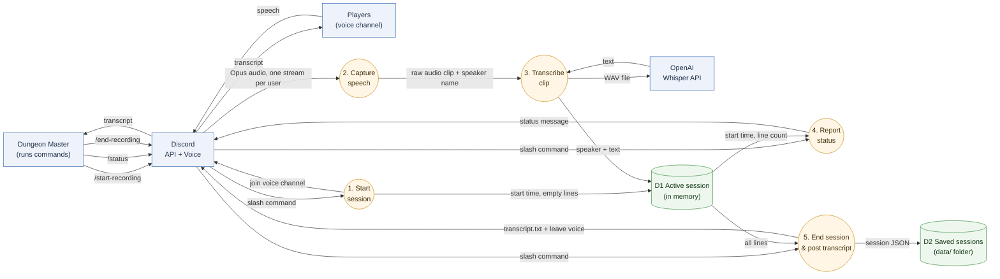
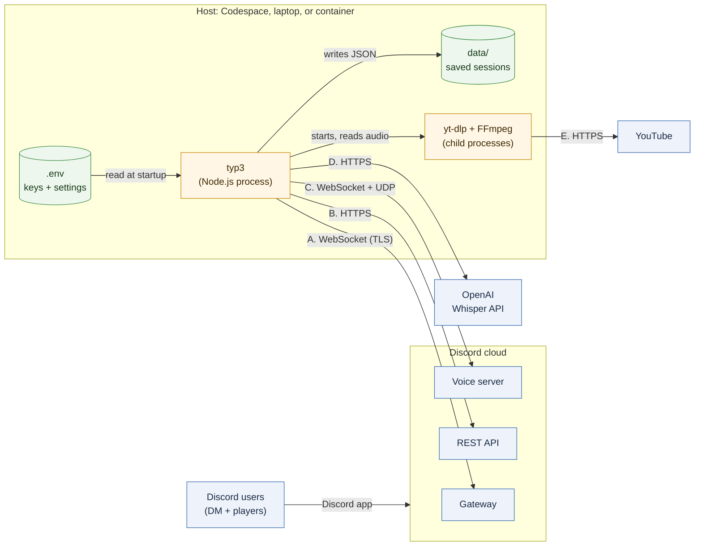
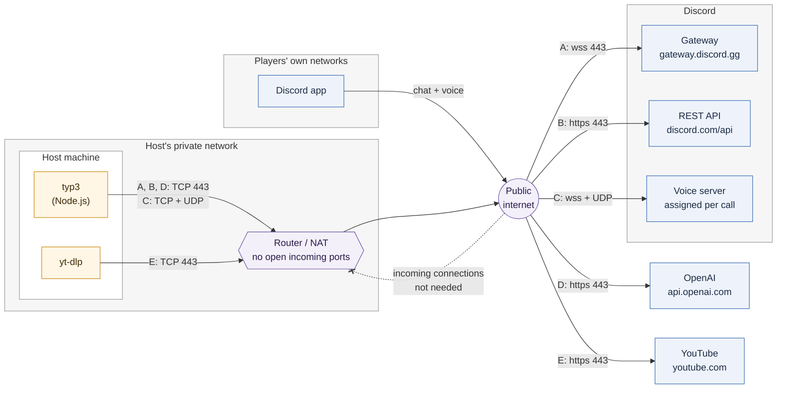
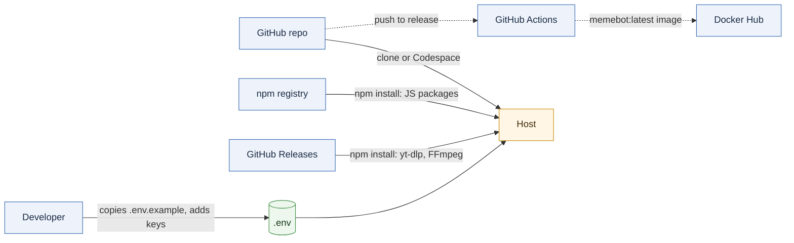

# typ3 Architecture Guide

typ3 is a Discord bot that acts as a session scribe for D&D and other tabletop games.
It joins a voice channel, transcribes what each player says with OpenAI Whisper, and posts the transcript when the session ends.

This guide is for three readers:

- **Future us**: where things live and how to change them
- **Someone using the bot**: what happens to their voice
- **A future employer**: how we made our design choices

## Contents

| # | Section | Diagram | Owner |
|---|---------|---------|-------|
| 1 | [Data Flow: Voice to Transcript](#1-data-flow-voice-to-transcript) | Data flow diagram | Aaron |
| 2 | [System Context & Network](#2-system-context--network) | System context / network diagram | Dilshan |
| 3 | [Command Lifecycle](#3-command-lifecycle) | Activity diagram | Leo |
| 4 | [Code Structure & Adding a Command](#4-code-structure--adding-a-command) | Class / module diagram | Slavik |

---

## 1. Data Flow: Voice to Transcript

**Author:** Aaron

This section follows the **data**, not the code: what happens to a player's voice from the moment they speak until the transcript shows up in Discord.

### Diagram

**Legend:** blue box = outside the bot, orange circle = something the bot does, green cylinder = where data is kept.
Arrow labels name the **data** moving.

### Step by step

| Step | What happens | Code |
|------|--------------|------|
| 1. Start session | Bot joins the DM's voice channel and creates an empty session | `commands/startRecording.js`, `scribe/sessions.js` |
| 2. Capture speech | Discord sends each person's audio separately. The bot cuts a clip when that person is quiet for 1 second and decodes it to raw audio | `scribe/listen.js` |
| 3. Transcribe clip | Clips under 1 second are skipped. The rest get a WAV header and go to Whisper. The text is saved with the speaker's name | `scribe/listen.js`, `scribe/whisper.js` |
| 4. Report status | `/status` reads the session and replies with how long it's been recording and how many lines were transcribed | `commands/status.js` |
| 5. End session | Bot stops capturing speech, leaves voice (unless music is playing), saves the session to `data/`, and posts `transcript.txt` in the channel | `commands/endRecording.js` |

### Data stores

| Store | What's in it | Where | How long |
|-------|--------------|-------|----------|
| D1 Active session | Start time + list of `{ speaker, text }` | Memory (a `Map`, one per server) | Until `/end-recording` or the bot restarts |
| D2 Saved sessions | One JSON file per finished session | `data/` folder (not committed to GitHub) | Until deleted |

Audio is never stored. Each clip only exists long enough to be sent to Whisper.

### Design choices

- **Speaker names come from Discord, not guessed.**
  Discord gives one audio stream per user, so we always know who said what.
- **1 second of silence = one clip.**
  Short clips keep transcription moving during the session instead of all at the end.
- **Clips under 1 second are skipped.**
  Whisper tends to make up words when it only hears a short noise.
- **Only text is kept.**
  Raw audio is the most sensitive data, so it's thrown away right after transcription.
- **Secrets stay out of the code.**
  The Discord token and OpenAI key are read from `.env`, which is git-ignored.
- **Saved transcripts stay off GitHub.**
  `data/` is in `.gitignore` so players' conversations are never committed.

### Known limits

- If the bot crashes mid-session, the active session (D1) is lost, because it's only in memory until `/end-recording`.
- If Whisper fails, that clip is logged and skipped. Players aren't told.
- Players aren't warned they're being recorded beyond the "Recording started" message.
- Music from the bot isn't transcribed, but if it leaks from a player's speakers into their mic, Whisper can pick it up.

### Music

Anyone in a voice channel can paste a YouTube link in chat and the bot plays it there (`music/player.js`, `music/youtube.js`).
A new link replaces the current song, and `/stop-music` stops it.
`yt-dlp` fetches the audio and FFmpeg converts it for Discord. Both are installed by npm. `yt-dlp` needs Python 3.10+.

- **"In voice" no longer means "recording".**
  Music and recording share one voice connection, so recording state comes from the session (`scribe/sessions.js`).
  A session only exists between `/start-recording` and `/end-recording`, and speech is never captured without one.
- **The bot leaves voice when nothing needs it.**
  It stays while a session is recording or music is playing.
- **Only the video id is taken from chat.**
  The bot builds the URL itself, so a message can't pass options to `yt-dlp` or send it to another website.

If YouTube playback stops working, `yt-dlp` is usually out of date. `npm rebuild youtube-dl-exec` downloads the latest version.

---

## 2. System Context & Network

**Author:** Dilshan

This section zooms out from the code: what typ3 connects to, where it runs, and how it gets its code and keys.

### Diagram

**Legend:** blue box = outside the bot, orange box = a program we run, green cylinder = a file on the host.
Network arrows start at the side that opens the connection. Every one of them starts at the host or at a user.

### Network connections

This diagram shows the network path each connection takes. The letters match the table below. The host's private network is your home router on a laptop, or GitHub's cloud in a Codespace.

**Legend:** blue box = outside the bot, orange box = a program we run, purple = network equipment and the internet.
The dashed arrow with an X marks traffic the bot never needs: nothing has to connect in to it.

| | Connection | Protocol | What it carries | Key used | Code |
|---|------------|----------|-----------------|----------|------|
| A | Bot → Discord Gateway | WebSocket over TLS, port 443 | Slash commands, chat messages, new members, voice state | `TOKEN` | `app.js`, `events/` |
| B | Bot → Discord REST API | HTTPS, port 443 | Command registration, replies, `transcript.txt` uploads | `TOKEN` | `events/ready.js`, `commands/` |
| C | Bot → Discord voice server | WebSocket for setup, UDP for audio (Discord picks the address and port) | Encrypted Opus audio, both ways | Session details sent over A | `scribe/listen.js`, `music/player.js` |
| D | Bot → OpenAI | HTTPS, port 443 | WAV clips out, text back | `OPENAI_API_KEY` | `scribe/whisper.js` |
| E | yt-dlp → YouTube | HTTPS, port 443 | Video title and audio | None | `music/youtube.js` |

The bot never talks to a player directly. Discord sits between them, so players only need the Discord app.

### Where the bot runs

typ3 is one Node.js process, and it's only online while that process is running. There's no permanent server yet.

| Host | Start with | Settings come from | Good to know |
|------|------------|--------------------|--------------|
| GitHub Codespace | `npm start` | `.env` | Runs Node 22 from `.devcontainer/`. The bot stops when the Codespace stops, and YouTube often blocks these servers |
| Your own computer | `npm start` | `.env` | Best for music. Needs Node 22.12+ and Python 3.10+ |
| Docker container | `npm run prod` (the image's entry point) | Environment variables passed to the container | `dotenv` isn't installed here, so a `.env` file is ignored |

### How npm and `.env` fit in

**Legend:** solid arrows = setting up a host, dashed arrows = the Docker image build.

- **npm** installs what's in `package-lock.json`.
  Two packages then download a program during install: `youtube-dl-exec` gets the latest `yt-dlp`, and `ffmpeg-static` gets FFmpeg. Both come from GitHub, so `npm install` needs access to it.
- **`npm start`** builds `src/` into `build/` with esbuild, then runs the bot with `dotenv` loading `.env`.
- **`.env`** holds the three settings below. It stays on the host and is git-ignored.

| Setting | What it's for | Secret? |
|---------|---------------|---------|
| `TOKEN` | Logs the bot in to Discord | Yes. Anyone with it can act as the bot |
| `OPENAI_API_KEY` | Pays for Whisper calls | Yes. Anyone with it can spend on our account |
| `CHANNEL_NAME` | Text channel for the ready and welcome messages | No |

### Design choices

- **The bot only makes outgoing connections.**
  Commands arrive over the Gateway WebSocket, not a webhook, so typ3 needs no public URL or open port. That's why it can run on a laptop behind a home router.
- **Whisper is a hosted API.**
  The bot needs no GPU and runs on a small machine. The trade-off is that players' voices leave the host and go to OpenAI, and a transcript depends on OpenAI being reachable.
- **Keys are read from the environment.**
  The same code runs on every host, and only the source of the settings changes.
- **YouTube is handled by a separate program.**
  `yt-dlp` runs as a child process, so a failed download doesn't crash the bot. It also keeps YouTube traffic out of our code.

### Known limits

- There's no permanent host, so the bot is offline unless someone is running it.
- A Codespace stops after it sits idle (30 minutes by default), which takes the bot and any active session with it.
- Networks that block UDP break voice while commands keep working. `/start-recording` still says recording started, because it doesn't wait for the voice connection to finish.
- Audio is stored nowhere on our side, but each clip does reach OpenAI. Once it's there, OpenAI's data policy applies.
- `.devcontainer/on-create.sh` copies `/workspaces/memebot_discord/.env-sample`, a path and file that don't exist in this repo. In a Codespace, copy `.env.example` to `.env` yourself.
- The Docker image is built on pushes to a `release` branch, but that branch doesn't exist yet, and nothing deploys the image after it reaches Docker Hub.
- In a container, `data/` is lost when the container is replaced unless it's on a mounted volume.

---

## 3. Command Lifecycle

**Author:** Leo

_TODO: Activity diagram for one slash command: user types it → Discord sends an interaction → `events/interactionCreate.js` finds the command → the command replies. Include the error path._

---

## 4. Code Structure & Adding a Command

**Author:** Slavik

_TODO: Module/class diagram of `src/` (app.js, events, commands, scribe, helpers) and a short checklist for adding a new slash command (`commands/index.js`, tests)._
