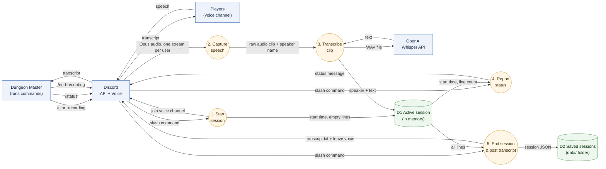
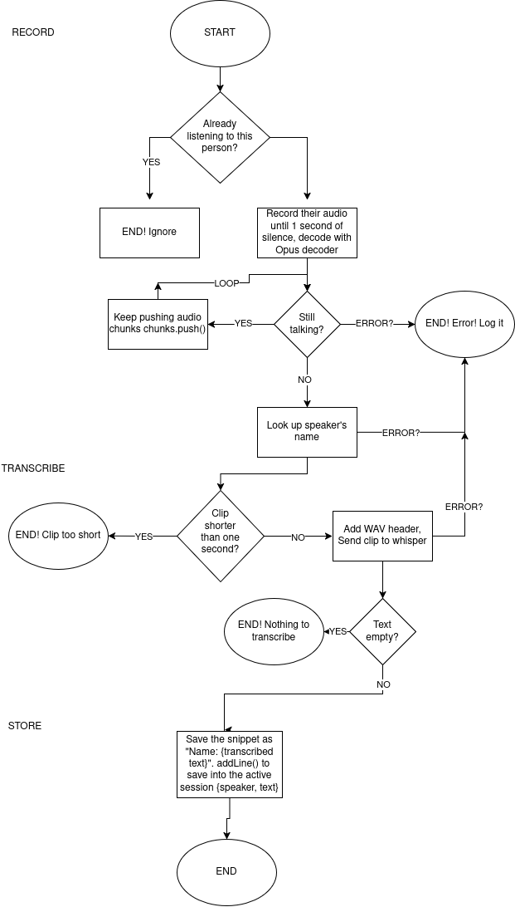
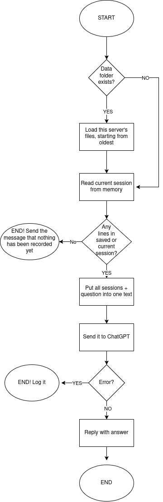

# typ3 Architecture Guide

typ3 is a Discord bot that acts as a session scribe for D&D and other tabletop games.
It joins a voice channel, transcribes what each player says with OpenAI Whisper, and posts the transcript when the session ends.

This guide is for three readers:

- **Future us**: where things live and how to change them
- **Someone using the bot**: what happens to their voice
- **A future employer**: how we made our design choices

## Contents

| # | Section | Diagram | Owner |
|---|---------|---------|-------|
| 1 | [Data Flow: Voice to Transcript](#1-data-flow-voice-to-transcript) | Data flow diagram | Aaron |
| 2 | [System Context & Network](#2-system-context--network) | System context / network diagram | Dilshan |
| 3 | [Voice Clips & /ask](#3-voice-clips--ask) | Control flow graphs | Leo |
| 4 | [Code Structure & Adding a Command](#4-code-structure--adding-a-command) | Class / module diagram | Slavik |

---

## 1. Data Flow: Voice to Transcript

**Author:** Aaron

This section follows the **data**, not the code: what happens to a player's voice from the moment they speak until the transcript shows up in Discord.

### Diagram

**Legend:** blue box = outside the bot, orange circle = something the bot does, green cylinder = where data is kept.
Arrow labels name the **data** moving.

### Step by step

| Step | What happens | Code |
|------|--------------|------|
| 1. Start session | Bot joins the DM's voice channel and creates an empty session | `commands/startRecording.js`, `scribe/sessions.js` |
| 2. Capture speech | Discord sends each person's audio separately. The bot cuts a clip when that person is quiet for 1 second and decodes it to raw audio | `scribe/listen.js` |
| 3. Transcribe clip | Clips under 1 second are skipped. The rest get a WAV header and go to Whisper. The text is saved with the speaker's name | `scribe/listen.js`, `scribe/whisper.js` |
| 4. Report status | `/status` reads the session and replies with how long it's been recording and how many lines were transcribed | `commands/status.js` |
| 5. End session | Bot stops capturing speech, leaves voice (unless music is playing), saves the session to `data/`, and posts `transcript.txt` in the channel | `commands/endRecording.js` |

### Data stores

| Store | What's in it | Where | How long |
|-------|--------------|-------|----------|
| D1 Active session | Start time + list of `{ speaker, text }` | Memory (a `Map`, one per server) | Until `/end-recording` or the bot restarts |
| D2 Saved sessions | One JSON file per finished session | `data/` folder (not committed to GitHub) | Until deleted |

Audio is never stored. Each clip only exists long enough to be sent to Whisper.

### Design choices

- **Speaker names come from Discord, not guessed.**
  Discord gives one audio stream per user, so we always know who said what.
- **1 second of silence = one clip.**
  Short clips keep transcription moving during the session instead of all at the end.
- **Clips under 1 second are skipped.**
  Whisper tends to make up words when it only hears a short noise.
- **Only text is kept.**
  Raw audio is the most sensitive data, so it's thrown away right after transcription.
- **Secrets stay out of the code.**
  The Discord token and OpenAI key are read from `.env`, which is git-ignored.
- **Saved transcripts stay off GitHub.**
  `data/` is in `.gitignore` so players' conversations are never committed.

### Known limits

- If the bot crashes mid-session, the active session (D1) is lost, because it's only in memory until `/end-recording`.
- If Whisper fails, that clip is logged and skipped. Players aren't told.
- Players aren't warned they're being recorded beyond the "Recording started" message.
- Music from the bot isn't transcribed, but if it leaks from a player's speakers into their mic, Whisper can pick it up.

### Music

Anyone in a voice channel can paste a YouTube link in chat and the bot plays it there (`music/player.js`, `music/youtube.js`).
A new link replaces the current song, and `/stop-music` stops it.
`yt-dlp` fetches the audio and FFmpeg converts it for Discord. Both are installed by npm. `yt-dlp` needs Python 3.10+.

- **"In voice" no longer means "recording".**
  Music and recording share one voice connection, so recording state comes from the session (`scribe/sessions.js`).
  A session only exists between `/start-recording` and `/end-recording`, and speech is never captured without one.
- **The bot leaves voice when nothing needs it.**
  It stays while a session is recording or music is playing.
- **Only the video id is taken from chat.**
  The bot builds the URL itself, so a message can't pass options to `yt-dlp` or send it to another website.

If YouTube playback stops working, `yt-dlp` is usually out of date. `npm rebuild youtube-dl-exec` downloads the latest version.

---

## 2. System Context & Network

**Author:** Dilshan

_TODO: Show typ3 and everything it talks to (Discord users, Discord API, OpenAI Whisper, GitHub Codespaces), and how the network connects them. Where does the bot run? How do npm and `.env` fit in?_

---

## 3. Voice Clips & /ask

**Author:** Leo

These two control flow graphs show every path the code can take, step by step.

### 3.1 Transcribe audio clip

In plain words:

1. Someone starts talking. If the bot is already listening to them, it does nothing.
2. Otherwise it records their audio until they are quiet for 1 second.
3. It looks up the speaker's name.
4. Clips shorter than 1 second are thrown away, because Whisper makes up words when it only hears a short noise.
5. The clip is sent to Whisper, which turns it into text. If the text is empty, it's thrown away.
6. The line is saved to the active session as `{ speaker, text }`.

If anything goes wrong, the error is logged and that clip is lost. The bot keeps running.

Where it lives in the codebase:
Listen, record, look up name: `scribe/listen.js` --> `listenToSpeakers()`
Too short, empty text, save: `scribe/listen.js` --> `handleClip()`
Send to Whisper: `scribe/whisper.js` --> `transcribe()`
Active session: `scribe/sessions.js` --> `addLine()`

### 3.2 Answering a question with /ask

In plain words:

1. Load this server's saved sessions from the `data/` folder, if it exists.
2. Add the current session from memory.
3. If there are no lines at all, reply "Nothing has been transcribed yet."
4. Put all the sessions and the question into one text and send it to ChatGPT.
5. Reply with ChatGPT's answer. If ChatGPT fails, the error is logged.

Where it lives in the codebase:
Load saved sessions: `scribe/sessions.js` -->`getSavedSessions()`
Build the text, reply: `commands/ask.js`
Send to ChatGPT: scribe/chat.js` --> `askChatGPT()`

### Known limits

- Whisper still ocasionally invents words from brief noises if they last over 1 second.
- If `/end-recording` runs while the last clip is still at Whisper, that line is missing from the transcript.
- If ChatGPT fails, the user only sees "thinking..." with no answer.
- `/ask` sends every saved session each time, so it gets slower and costs more as sessions pile up.

---

## 4. Code Structure & Adding a Command

**Author:** Slavik

_TODO: Module/class diagram of `src/` (app.js, events, commands, scribe, helpers) and a short checklist for adding a new slash command (`commands/index.js`, tests)._
