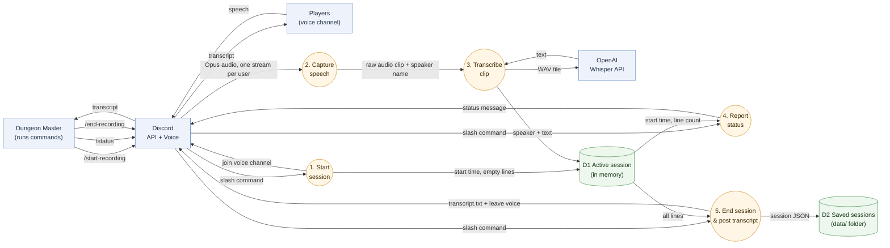

# typ3 Architecture Guide

typ3 is a Discord bot that acts as a session scribe for D&D and other tabletop games.
It joins a voice channel, transcribes what each player says with OpenAI Whisper, and posts the transcript when the session ends.

This guide is for three readers:

- **Future us**: where things live and how to change them
- **Someone using the bot**: what happens to their voice
- **A future employer**: how we made our design choices

## Contents

| # | Section | Diagram | Owner |
|---|---------|---------|-------|
| 1 | [Data Flow: Voice to Transcript](#1-data-flow-voice-to-transcript) | Data flow diagram | Aaron |
| 2 | [System Context & Network](#2-system-context--network) | System context / network diagram | Dilshan |
| 3 | [Command Lifecycle](#3-command-lifecycle) | Activity diagram | Leo |
| 4 | [Code Structure & Adding a Command](#4-code-structure--adding-a-command) | Class / module diagram | Slavik |

---

## 1. Data Flow: Voice to Transcript

**Author:** Aaron

This section follows the **data**, not the code: what happens to a player's voice from the moment they speak until the transcript shows up in Discord.

### Diagram

**Legend:** blue box = outside the bot, orange circle = something the bot does, green cylinder = where data is kept.
Arrow labels name the **data** moving.

### Step by step

| Step | What happens | Code |
|------|--------------|------|
| 1. Start session | Bot joins the DM's voice channel and creates an empty session | `commands/startRecording.js`, `scribe/sessions.js` |
| 2. Capture speech | Discord sends each person's audio separately. The bot cuts a clip when that person is quiet for 1 second and decodes it to raw audio | `scribe/listen.js` |
| 3. Transcribe clip | Clips under 1 second are skipped. The rest get a WAV header and go to Whisper. The text is saved with the speaker's name | `scribe/listen.js`, `scribe/whisper.js` |
| 4. Report status | `/status` reads the session and replies with how long it's been recording and how many lines were transcribed | `commands/status.js` |
| 5. End session | Bot leaves voice, saves the session to `data/`, and posts `transcript.txt` in the channel | `commands/endRecording.js` |

### Data stores

| Store | What's in it | Where | How long |
|-------|--------------|-------|----------|
| D1 Active session | Start time + list of `{ speaker, text }` | Memory (a `Map`, one per server) | Until the next session starts or the bot restarts |
| D2 Saved sessions | One JSON file per finished session | `data/` folder (not committed to GitHub) | Until deleted |

Audio is never stored. Each clip only exists long enough to be sent to Whisper.

### Design choices

- **Speaker names come from Discord, not guessed.**
  Discord gives one audio stream per user, so we always know who said what.
- **1 second of silence = one clip.**
  Short clips keep transcription moving during the session instead of all at the end.
- **Clips under 1 second are skipped.**
  Whisper tends to make up words when it only hears a short noise.
- **Only text is kept.**
  Raw audio is the most sensitive data, so it's thrown away right after transcription.
- **Secrets stay out of the code.**
  The Discord token and OpenAI key are read from `.env`, which is git-ignored.
- **Saved transcripts stay off GitHub.**
  `data/` is in `.gitignore` so players' conversations are never committed.

### Known limits

- If the bot crashes mid-session, the active session (D1) is lost, because it's only in memory until `/end-recording`.
- If Whisper fails, that clip is logged and skipped. Players aren't told.
- Players aren't warned they're being recorded beyond the "Recording started" message.

---

## 2. System Context & Network

**Author:** Dilshan

_TODO: Show typ3 and everything it talks to (Discord users, Discord API, OpenAI Whisper, GitHub Codespaces), and how the network connects them. Where does the bot run? How do npm and `.env` fit in?_

---

## 3. Command Lifecycle

**Author:** Leo

_TODO: Activity diagram for one slash command: user types it → Discord sends an interaction → `events/interactionCreate.js` finds the command → the command replies. Include the error path._

---

## 4. Code Structure & Adding a Command

**Author:** Slavik

_TODO: Module/class diagram of `src/` (app.js, events, commands, scribe, helpers) and a short checklist for adding a new slash command (`commands/index.js`, tests)._
