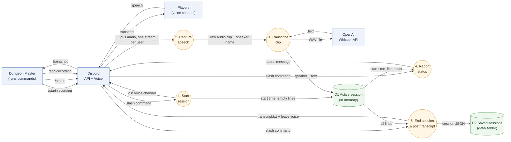
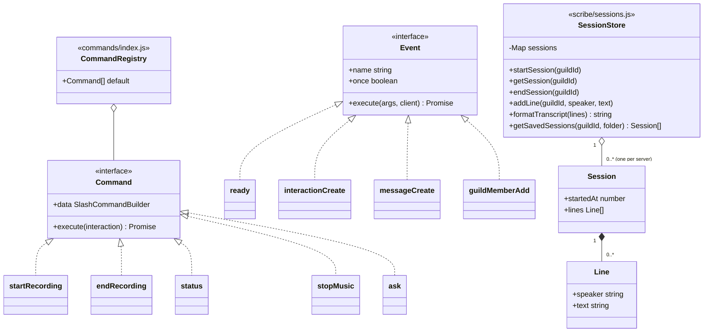

# typ3 Architecture Guide

typ3 is a Discord bot that acts as a session scribe for D&D and other tabletop games.
It joins a voice channel, transcribes what each player says with OpenAI Whisper, and posts the transcript when the session ends.

This guide is for three readers:

- **Future us**: where things live and how to change them
- **Someone using the bot**: what happens to their voice
- **A future employer**: how we made our design choices

## Contents

| # | Section | Diagram | Owner |
|---|---------|---------|-------|
| 1 | [Data Flow: Voice to Transcript](#1-data-flow-voice-to-transcript) | Data flow diagram | Aaron |
| 2 | [System Context & Network](#2-system-context--network) | System context / network diagram | Dilshan |
| 3 | [Voice Clips & /ask](#3-voice-clips--ask) | Control flow graphs | Leo |
| 4 | [Code Structure & Adding a Command](#4-code-structure--adding-a-command) | Class / module diagram | Slavik |

---

## 1. Data Flow: Voice to Transcript

**Author:** Aaron

This section follows the **data**, not the code: what happens to a player's voice from the moment they speak until the transcript shows up in Discord.

### Diagram



**Legend:** blue box = outside the bot, orange circle = something the bot does, green cylinder = where data is kept.
Arrow labels name the **data** moving.

### Step by step

| Step | What happens | Code |
|------|--------------|------|
| 1. Start session | Bot joins the DM's voice channel and creates an empty session | `commands/startRecording.js`, `scribe/sessions.js` |
| 2. Capture speech | Discord sends each person's audio separately. The bot cuts a clip when that person is quiet for 1 second and decodes it to raw audio | `scribe/listen.js` |
| 3. Transcribe clip | Clips under 1 second are skipped. The rest get a WAV header and go to Whisper. The text is saved with the speaker's name | `scribe/listen.js`, `scribe/whisper.js` |
| 4. Report status | `/status` reads the session and replies with how long it's been recording and how many lines were transcribed | `commands/status.js` |
| 5. End session | Bot stops capturing speech, leaves voice (unless music is playing), saves the session to `data/`, and posts `transcript.txt` in the channel | `commands/endRecording.js` |

### Data stores

| Store | What's in it | Where | How long |
|-------|--------------|-------|----------|
| D1 Active session | Start time + list of `{ speaker, text }` | Memory (a `Map`, one per server) | Until `/end-recording` or the bot restarts |
| D2 Saved sessions | One JSON file per finished session | `data/` folder (not committed to GitHub) | Until deleted |

Audio is never stored. Each clip only exists long enough to be sent to Whisper.

### Design choices

- **Speaker names come from Discord, not guessed.**
  Discord gives one audio stream per user, so we always know who said what.
- **1 second of silence = one clip.**
  Short clips keep transcription moving during the session instead of all at the end.
- **Clips under 1 second are skipped.**
  Whisper tends to make up words when it only hears a short noise.
- **Only text is kept.**
  Raw audio is the most sensitive data, so it's thrown away right after transcription.
- **Secrets stay out of the code.**
  The Discord token and OpenAI key are read from `.env`, which is git-ignored.
- **Saved transcripts stay off GitHub.**
  `data/` is in `.gitignore` so players' conversations are never committed.

### Known limits

- If the bot crashes mid-session, the active session (D1) is lost, because it's only in memory until `/end-recording`.
- If Whisper fails, that clip is logged and skipped. Players aren't told.
- Players aren't warned they're being recorded beyond the "Recording started" message.
- Music from the bot isn't transcribed, but if it leaks from a player's speakers into their mic, Whisper can pick it up.

### Music

Anyone in a voice channel can paste a YouTube link in chat and the bot plays it there (`music/player.js`, `music/youtube.js`).
A new link replaces the current song, and `/stop-music` stops it.
`yt-dlp` fetches the audio and FFmpeg converts it for Discord. Both are installed by npm. `yt-dlp` needs Python 3.10+.

- **"In voice" no longer means "recording".**
  Music and recording share one voice connection, so recording state comes from the session (`scribe/sessions.js`).
  A session only exists between `/start-recording` and `/end-recording`, and speech is never captured without one.
- **The bot leaves voice when nothing needs it.**
  It stays while a session is recording or music is playing.
- **Only the video id is taken from chat.**
  The bot builds the URL itself, so a message can't pass options to `yt-dlp` or send it to another website.

If YouTube playback stops working, `yt-dlp` is usually out of date. `npm rebuild youtube-dl-exec` downloads the latest version.

---

## 2. System Context & Network

**Author:** Dilshan

_TODO: Show typ3 and everything it talks to (Discord users, Discord API, OpenAI Whisper, GitHub Codespaces), and how the network connects them. Where does the bot run? How do npm and `.env` fit in?_

---

## 3. Voice Clips & /ask

**Author:** Leo

These two control flow graphs show every path the code can take, step by step.

### 3.1 Transcribe audio clip


In plain words:

1. Someone starts talking. If the bot is already listening to them, it does nothing.
2. Otherwise it records their audio until they are quiet for 1 second.
3. It looks up the speaker's name.
4. Clips shorter than 1 second are thrown away, because Whisper makes up words when it only hears a short noise.
5. The clip is sent to Whisper, which turns it into text. If the text is empty, it's thrown away.
6. The line is saved to the active session as `{ speaker, text }`.

If anything goes wrong, the error is logged and that clip is lost. The bot keeps running.

Where it lives in the codebase:
Listen, record, look up name: `scribe/listen.js` --> `listenToSpeakers()`
Too short, empty text, save: `scribe/listen.js` --> `handleClip()`
Send to Whisper: `scribe/whisper.js` --> `transcribe()`
Active session: `scribe/sessions.js` --> `addLine()`

### 3.2 Answering a question with /ask


In plain words:

1. Load this server's saved sessions from the `data/` folder, if it exists.
2. Add the current session from memory.
3. If there are no lines at all, reply "Nothing has been transcribed yet."
4. Put all the sessions and the question into one text and send it to ChatGPT.
5. Reply with ChatGPT's answer. If ChatGPT fails, the error is logged.

Where it lives in the codebase:
Load saved sessions: `scribe/sessions.js` -->`getSavedSessions()`
Build the text, reply: `commands/ask.js`
Send to ChatGPT: scribe/chat.js` --> `askChatGPT()`

### Known limits

- Whisper still ocasionally invents words from brief noises if they last over 1 second.
- If `/end-recording` runs while the last clip is still at Whisper, that line is missing from the transcript.
- If ChatGPT fails, the user only sees "thinking..." with no answer.
- `/ask` sends every saved session each time, so it gets slower and costs more as sessions pile up.

---

## 4. Code Structure & Adding a Command

**Author:** Slavik

This section is about the **code**: what each folder in `src/` is for, the shape every command and event follows, and what you need to touch to add a new slash command.

### 4.1 What each folder does

| Folder | Job | Rule of thumb |
|--------|-----|---------------|
| `app.js` | Creates the client with the intents we need and logs in with `TOKEN` | Only touch this if you need a new Discord intent |
| `helpers/` | Finds every `.js` file in `events/` and hooks it up to the client | You shouldn't need to change it |
| `events/` | One file per Discord event. Each file is picked up automatically | Keep these thin. They route to commands or helpers |
| `commands/` | One file per slash command, plus `index.js` that lists them all | New user-facing features usually start here |
| `scribe/` | Recording, transcription, saved sessions, and ChatGPT | Anything about transcripts goes here |
| `music/` | YouTube playback in voice | Anything about music goes here |

### 4.2 Class diagram

JavaScript doesn't make us declare interfaces, but every command and every event follows the same shape. This is what `interactionCreate.js` and `loadEvents.js` expect.



- `data` is what Discord shows in the `/` menu (name, description, options).
- `execute` runs when someone uses the command. It has 3 seconds to reply, or it has to call `deferReply()` first like `/ask` does.
- `once: true` means the event only fires once (`ready`). Leave it out for events that fire every time.

### 4.3 How a command gets from code to Discord

1. `npm start` runs esbuild, which compiles `src/` into `build/`, then starts `build/app.js` with the values from `.env`.
2. `loadEvents` attaches every file in `events/` to the client.
3. When the bot logs in, `ready.js` sends the `data` of every command in `commands/index.js` to each server the bot is in. That's what makes them show up in the `/` menu.
4. When someone runs a command, `interactionCreate.js` finds the one with the matching name and calls `execute`. If it throws, the error is logged and the bot keeps running.

Because commands are registered on startup, **a new command only shows up after you restart the bot.**

### 4.4 Checklist: adding a new slash command

Example: a `/recap` command ([#15](https://github.com/CSS360-2026-Au-E/Group-2-Typ3-MemeBot/issues/15)).

1. **Create `src/commands/recap.js`** with the same shape as the others:

   ```js
   import { SlashCommandBuilder } from "discord.js";

   const command = {
     data: new SlashCommandBuilder()
       .setName("recap") // lowercase, dashes allowed, no spaces
       .setDescription("Get a short recap of the last session"),
     async execute(interaction) {
       return interaction.reply("...");
     },
   };

   export default command;
   ```

2. **Add it to `src/commands/index.js`.** Commands are listed by hand, not auto-loaded. If you skip this, the command won't show up.
3. **Put the real logic in `scribe/` or `music/`, not in the command.** For `/recap`, `getSavedSessions()` and `formatTranscript()` in `sessions.js` and `askChatGPT()` in `chat.js` already do most of the work.
4. **If it might take more than 3 seconds** (anything that calls OpenAI), call `await interaction.deferReply()` and answer with `editReply()`.
5. **Write a test in `tests/recap.spec.js`.** Use a fake interaction object (see `tests/ask.spec.js`) and pass in a fake for anything that hits the network.
6. **Run `npm test`**, then restart the bot with `npm start` and try it in Discord.
7. **Update the README feature list** and the "Planned" embed in `events/ready.js` if the command was listed there.

**Adding an event** is simpler: drop a new file in `src/events/` that exports `{ name, execute }`. `loadEvents` finds it on startup, so there's no list to update. `name` has to be a real discord.js event name.

### Patterns we use

- **Registry.** `commands/index.js` is the one place that lists every command. `ready.js` and `interactionCreate.js` both read from it, so they can't get out of sync.
- **Thin handlers, shared logic.** Commands and events mostly check input and reply. The actual work lives in `scribe/` and `music/` so more than one command can use it (`/status`, `/end-recording`, `/ask`, and the music player all read `sessions.js`).
- **Dependency injection for tests.** Functions that call outside services take them as an optional argument with a real default, like `execute(interaction, ask = askChatGPT)` or `handleClip(..., transcribe = whisperTranscribe)`. Tests pass in fakes, so they run without internet or API keys.
- **One error boundary.** `interactionCreate.js` and `messageCreate.js` wrap everything in `try/catch`. One broken command can't take the whole bot down.
- **Module state, one entry per server.** `sessions.js` and `player.js` each keep a `Map` keyed by server id. That's why two servers can record at the same time without mixing transcripts.

### Known limits

- Forgetting step 2 is the easiest mistake to make. The command file exists, tests pass, but Discord never sees it.
- `ready.js` re-registers every command on every restart. That's fine for a handful of servers but it's slow if the bot ends up in a lot of them.
- `ready.js` does two jobs (registering commands and posting the welcome embed). Splitting those would make it easier to read.
- State lives in module-level `Map`s, so it's shared by everything that imports the module. Tests use a different server id per test so they don't step on each other.
