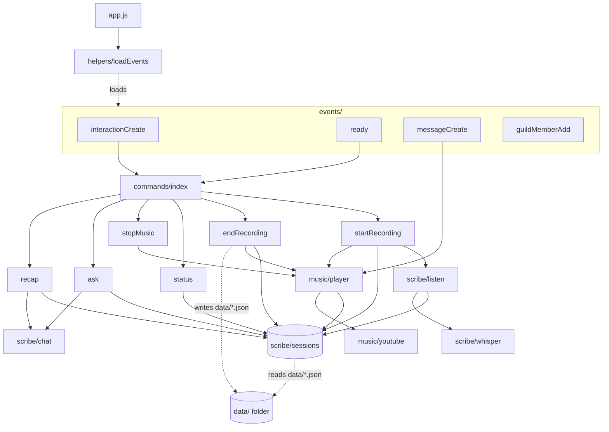

# Code Analysis Report — D&D Session Scribe (MemeBot)

This is our group's shared report for **Task 5: Code Analysis & Hardening**. We looked for bugs, gaps and technical debt in the bot, wrote down what we found, and turned the findings into user stories on our [Kanban board](https://github.com/orgs/CSS360-2026-Au-E/projects/10).

## How to contribute

1. Put your name next to the two tasks you picked in the table below.
2. Fill in **only your own task sections**. Use the template already in each section (Owner, What we did, Findings, Evidence, User stories).
3. Link evidence: file links like [`src/commands/ask.js:31`](src/commands/ask.js#L31), commands you ran, test output, screenshots in [`docs/`](docs/).
4. Add your user stories (at least 2) to the [User Stories](#user-stories) table, with a link to the issue.
5. Add your time spent and a short reflection at the bottom.
6. Open a PR for your changes so merges don't overwrite each other.

## Task assignments

| #   | Task                           | Owner(s) |
| --- | ------------------------------ | -------- |
| 1   | Technical debt and code smells | Dilshan  |
| 2   | Cyclomatic complexity          | Leo      |
| 3   | Cohesion and coupling          | Aaron    |
| 4   | Test coverage                  | Aaron    |
| 5   | Threat model                   | Slavik   |
| 6   | Fuzzer (fast-check)            | Slavik   |
| 7   | Unit tests (at least 3)        | Leo      |
| 8   | Smoke test                     | Dilshan  |

We have four members, so each person took two tasks and we did not do CI/CD or an own-idea task.

---

## 1. Technical Debt and Code Smells

**Owner:** Dilshan

### What I did

I read every file in [`src/`](src/), plus [`package.json`](package.json), [`nodemon.json`](nodemon.json), the CI workflow and the README. For each one I looked for duplicated code, long functions, missing error handling, missing input checks, magic numbers, dead code and docs that no longer match the code. I then ranked the findings by how much they hurt users or developers.

### Findings

#### Duplicated code

| Smell                                            | Where                                                                                                                                                                   | Why it matters                                                               |
| ------------------------------------------------ | ----------------------------------------------------------------------------------------------------------------------------------------------------------------------- | ---------------------------------------------------------------------------- |
| Transcript formatting is written twice           | [`endRecording.js:29`](src/commands/endRecording.js#L29) re-implements [`formatTranscript`](src/scribe/sessions.js#L25) from `sessions.js` (even the comment is copied) | Change the format in one place and `/end-recording` and `/ask` stop matching |
| Session label written twice                      | [`ask.js:41`](src/commands/ask.js#L41) and [`recap.js:26`](src/commands/recap.js#L26)                                                                                   | "Session 2" in `/ask` could stop meaning the same thing as in `/recap`       |
| Minutes recorded calculated twice                | [`endRecording.js:26`](src/commands/endRecording.js#L26) and [`status.js:18`](src/commands/status.js#L18)                                                               | Same logic, two places to fix                                                |
| Discord's 2000-character limit as a magic number | [`ask.js:33`](src/commands/ask.js#L33) and [`recap.js:34`](src/commands/recap.js#L34)                                                                                   | Should be one named constant (and long answers are cut off silently)         |
| "Find the bot's text channel" code copied        | [`ready.js:29-34`](src/events/ready.js#L29-L34) and [`guildMemberAdd.js:8-13`](src/events/guildMemberAdd.js#L8-L13)                                                     | Should be one helper                                                         |
| Embed colors hardcoded                           | `0x5b21b6` in [`ready.js:42`](src/events/ready.js#L42) and [`guildMemberAdd.js:35`](src/events/guildMemberAdd.js#L35)                                                   | Theme changes need a search                                                  |

#### Long, stale function

- [`ready.js` `execute`](src/events/ready.js#L9-L109) is ~100 lines and does three jobs: logging, registering commands, and posting a startup message.
- The second loop is mis-indented ([`ready.js:23-108`](src/events/ready.js#L23-L108)), and `if (!CHANNEL_NAME) … break` is checked inside the loop instead of once before it.
- The "Planned Session Scribe Commands" embed ([`ready.js:44-90`](src/events/ready.js#L44-L90)) says the commands are **"not currently available"**, but `/start-recording`, `/end-recording`, `/status`, `/ask` and `/recap` all exist now. It also advertises `/help` and `/settings`, which don't exist. Every time the bot starts, it tells the server the wrong thing.
- Command registration ([`ready.js:20`](src/events/ready.js#L20)) has no try/catch. If registering fails in one server, the whole handler stops and no server gets the startup message.

#### Missing error handling

- **`/ask` can hang on "thinking…".** [`ask.js:31-33`](src/commands/ask.js#L31-L33) calls `deferReply()` and then `ask()` with no try/catch. If OpenAI fails, the user never gets an answer. [`recap.js:31-38`](src/commands/recap.js#L31-L38) already does this correctly, so the two commands are inconsistent.
- **Failed commands are silent.** [`interactionCreate.js:16-18`](src/events/interactionCreate.js#L16-L18) logs the error but never replies, so the user sees "The application did not respond".
- **One bad save file breaks `/ask` and `/recap`.** [`sessions.js:37`](src/scribe/sessions.js#L37) calls `JSON.parse` on every file in `data/` with no try/catch. A single corrupt or half-written file throws for the whole server.
- **API responses are trusted blindly.** [`chat.js:26`](src/scribe/chat.js#L26) assumes `choices[0]` exists, and [`whisper.js:20`](src/scribe/whisper.js#L20) assumes `text` exists.
- **Possible crash in `stopMusic`.** [`player.js:43`](src/music/player.js#L43) calls `download.kill()` without `?.`. The entry is created with `download: null` ([`player.js:28`](src/music/player.js#L28)), so this can throw.
- [`endRecording.js:32-33`](src/commands/endRecording.js#L32-L33) writes the save file synchronously with no catch. If the write fails, the transcript is never posted either.
- [`app.js:20`](src/app.js#L20): `client.login()` has no `.catch`, so a bad token gives an unhandled promise rejection instead of a clear message.

#### Missing input and config validation

- `TOKEN` ([`app.js:5`](src/app.js#L5)) and `OPENAI_API_KEY` ([`chat.js:9`](src/scribe/chat.js#L9), [`whisper.js:11`](src/scribe/whisper.js#L11)) are never checked. A missing key sends `Bearer undefined` and fails later with a confusing error.
- `/ask` sends **every** saved transcript for the server on every question ([`ask.js:26-28`](src/commands/ask.js#L26-L28)), with no size limit. After enough sessions this will go over the model's context limit and cost more per question. The question itself has no length limit either.
- [`startRecording.js:29-36`](src/commands/startRecording.js#L29-L36) replies "Recording started!" without waiting for the voice connection to be ready, so a failed join still looks like success.

#### Magic numbers and hardcoded config

- Audio settings (`48000` Hz, `960` frame size, `1000` ms silence) are in [`listen.js:7,24,28`](src/scribe/listen.js#L7) and repeated in [`whisper.js:34-35`](src/scribe/whisper.js#L34-L35). They must match, but nothing ties them together.
- Model names `"gpt-5-mini"` ([`chat.js:2`](src/scribe/chat.js#L2)) and `"whisper-1"` ([`whisper.js:6`](src/scribe/whisper.js#L6)) are hardcoded instead of in `.env`.
- The `"data"` folder is hardcoded in two files ([`endRecording.js:32`](src/commands/endRecording.js#L32), [`sessions.js:31`](src/scribe/sessions.js#L31)).

#### Dead code and config debt

- `axios` is in [`package.json`](package.json) but never imported (both API clients use `fetch`).
- `client.events` ([`app.js:16`](src/app.js#L16)) is filled in by the loader but never read, and the `event.rest` branch in [`loadEvents.js`](src/helpers/loadEvents.js) is never used.
- [`nodemon.json`](nodemon.json) has no `exec` and `package.json` has no `main`, so `npm run dev` doesn't know what to run. It also ignores `*.test.ts` files that don't exist in this project.
- `package.json` still has the template's description and author.
- Tests run with a Node warning (`MODULE_TYPELESS_PACKAGE_JSON`) because the package type isn't set.
- The CI workflow ([`build-and-deploy.yml`](.github/workflows/build-and-deploy.yml)) only builds Docker images on the `release` branch and **never runs `npm test`**. It also uses old action versions (`checkout@v2` etc.).

#### Privacy and docs

- [`messageCreate.js:8`](src/events/messageCreate.js#L8) logs the text of **every** message in the server to the console. That is noisy and a privacy problem.
- README "Coming next" still lists "Ask the bot questions about past sessions", which `/ask` already does.

#### Inconsistent testability

- `/recap` lets tests inject `loadSessions` ([`recap.js:15`](src/commands/recap.js#L15)), but `/ask` doesn't ([`ask.js:17`](src/commands/ask.js#L17)). So `/ask` tests read the real `data/` folder, and the `/end-recording` test in [`recordingCommands.spec.js`](tests/recordingCommands.spec.js) writes into the real `data/` folder.

### Priority

| Priority | Finding                                                   | Effort |
| -------- | --------------------------------------------------------- | ------ |
| High     | `/ask` hangs on "thinking…" when OpenAI fails             | Small  |
| High     | Failed commands never reply to the user                   | Small  |
| High     | One corrupt save file breaks `/ask` and `/recap`          | Small  |
| High     | Startup message says working commands are "not available" | Small  |
| Medium   | `/ask` sends all transcripts with no size limit           | Medium |
| Medium   | Every chat message is logged                              | Small  |
| Medium   | No check for missing `TOKEN` / `OPENAI_API_KEY`           | Small  |
| Medium   | `stopMusic` can crash on `download.kill()`                | Small  |
| Medium   | CI never runs the tests                                   | Small  |
| Low      | Duplicated formatting, labels, minutes, channel lookup    | Small  |
| Low      | Magic numbers and hardcoded model names                   | Small  |
| Low      | Unused `axios`, dead loader code, broken `nodemon.json`   | Small  |

**What I'd fix first:** the four "High" items. They are all small changes and they're the ones users actually notice: a stuck reply, a silent failure, or a wrong startup message.

### User stories

See [User Stories](#user-stories): stories D1 and D2.

---

## 2. Cyclomatic Complexity

**Owner:** Leo

### What we did

_How you measured it (tool, command)._

### Findings

_Most complex functions, with scores._

### Evidence

_Command output / screenshot._

### User stories

_Links._

---

## 3. Cohesion and Coupling

**Owner:** Aaron

### What I did

I mapped every `import` between our own files in [`src/`](src/) to build a dependency graph. For each module I counted:

- **Fan-in:** how many of our files import it.
- **Fan-out:** how many of our files it imports.
- **Instability (I = fan-out ÷ (fan-in + fan-out)):** 0 means everything depends on it and it depends on nothing (stable). 1 means nothing depends on it (easy to change).

I also looked for coupling that doesn't show up as an `import`: shared global state, shared file-name formats and environment variables. For cohesion, I asked of each file: "Does it do one job?" This builds on Slavik's module diagram in [ARCHITECTURE.md section 4](ARCHITECTURE.md#4-code-structure--adding-a-command).

### Dependency graph



### Findings

#### Coupling metrics

| Module | Fan-in | Fan-out | Instability | Notes |
| --- | --- | --- | --- | --- |
| `scribe/sessions.js` | 7 | 0 | 0.00 | The hub. Almost every feature depends on it |
| `scribe/chat.js` | 2 | 0 | 0.00 | Only used by `/ask` and `/recap` |
| `scribe/whisper.js` | 1 | 0 | 0.00 | Only used by `listen.js` |
| `music/youtube.js` | 1 | 0 | 0.00 | Wraps yt-dlp |
| `music/player.js` | 4 | 2 | 0.33 | Used by both music **and** recording commands |
| `scribe/listen.js` | 1 | 2 | 0.67 | |
| `commands/startRecording.js` | 1 | 3 | 0.75 | Highest fan-out of any command, plus `@discordjs/voice` |
| other commands | 1 | 1–2 | 0.50–0.67 | |

**What's good:**

- **No circular imports.**
- **Dependencies point one way:** `events → commands → scribe/music`. The stable, low-level modules (`sessions`, `chat`, `whisper`, `youtube`) depend on none of our other files, which is what you want.
- **The two OpenAI clients and the yt-dlp wrapper are cleanly separated.** Swapping a model or a downloader only touches one file each.
- **Adding a command means touching only two files:** the new command file and [`commands/index.js`](src/commands/index.js).

#### Problem 1: Hidden coupling through global state

Three pieces of shared state live at module level and are reached from many files without being passed in:

- the `sessions` Map ([`sessions.js:5`](src/scribe/sessions.js#L5))
- the `music` Map ([`player.js:18`](src/music/player.js#L18))
- `@discordjs/voice`'s own connection registry (`getVoiceConnection`)

Music and recording **share one voice connection**. Both [`startRecording.js:29-33`](src/commands/startRecording.js#L29-L33) and [`player.js:74-78`](src/music/player.js#L74-L78) call `joinVoiceChannel` with `selfDeaf: false`, and each has to know about the other:

- `player.js` imports `getSession` so it doesn't leave voice during a recording ([`player.js:26`](src/music/player.js#L26)).
- `endRecording.js` imports `isMusicPlaying` so it doesn't leave voice during a song ([`endRecording.js:22-23`](src/commands/endRecording.js#L22-L23)).

That makes the `music` and `scribe` features **bidirectionally coupled**. Neither can change its "when do we leave voice" rule without breaking the other. Nothing owns the voice connection.

#### Problem 2: An implicit file-format contract between two files

The saved-session file name `<serverId>-<startedAt>.json` is **built** in [`endRecording.js:32-33`](src/commands/endRecording.js#L32-L33) and **parsed** in [`sessions.js:35-36`](src/scribe/sessions.js#L35-L36). The two files must agree, but nothing ties them together. If someone renames the file in `endRecording`, `/ask` and `/recap` silently stop finding old sessions and no test fails. The `"data"` folder name is repeated too.

#### Problem 3: External services are hard-wired in some commands

`/ask` and `/recap` accept the ChatGPT function as a parameter ([`recap.js:15`](src/commands/recap.js#L15)), so tests can pass in a fake. `/start-recording` imports `joinVoiceChannel` and `listenToSpeakers` directly, and `/end-recording` calls `fs` directly. These commands are tightly coupled to Discord voice and the disk.

**This is exactly where our test coverage is lowest** (see Task 4): `startRecording.js` is at 60% lines and its success path has never run in a test.

#### Problem 4: Environment coupling

`process.env` is read in five files:

- [`app.js`](src/app.js#L5)
- [`ready.js`](src/events/ready.js#L4)
- [`guildMemberAdd.js`](src/events/guildMemberAdd.js#L3)
- [`chat.js`](src/scribe/chat.js#L9)
- [`whisper.js`](src/scribe/whisper.js#L11)

There's no single config module, so no one place checks that the bot is set up correctly before it starts.

#### Cohesion by file

| Cohesion | Files | Why |
| --- | --- | --- |
| **High** (one job) | `chat.js`, `whisper.js`, `youtube.js`, `status.js`, `stopMusic.js`, `recap.js` | Each does exactly what its name says |
| **Medium** | `sessions.js` | Mixes three jobs: the live in-memory session, formatting text, and reading files from disk. But it doesn't **write** files, so persistence is split across two modules (Problem 2) |
| **Medium** | `player.js` | Music playback **plus** voice-connection lifetime rules that belong to the whole bot |
| **Low** | `endRecording.js` | Six jobs in one 47-line function: end the session, decide whether to leave voice, compute minutes, format text, write the file, build the attachment |
| **Low** | `ready.js` | Logging, command registration and a hardcoded 50-line embed (Dilshan's Task 1 covers the stale embed) |
| **Low** | `messageCreate.js` | Debug logging of every message plus the music trigger. Unrelated jobs |

### What I'd fix first

1. **Move saving into `sessions.js`.** Add `saveSession()` next to `getSavedSessions()` and use one helper for the file name. This fixes Problem 2 and the low cohesion of `endRecording.js` (story A2).
2. **Inject `joinVoiceChannel` / `listenToSpeakers` into `/start-recording`**, the way `/recap` already does with ChatGPT. This makes it testable and lets it report a failed join (story A1).
3. **Later:** a small `voice.js` that owns the connection and decides when to leave, so music and scribe stop importing each other.

### Evidence

- Import list generated with `grep -oE 'from "\.[^"]+"' src/**/*.js`. Results are in the table and graph above.

### User stories

See [User Stories](#user-stories): stories A1 and A2.

---

## 4. Test Coverage

**Owner:** Aaron

### What I did

I measured coverage with [c8](https://github.com/bcoe/c8), which uses Node's built-in coverage, so no code changes are needed. I used `--all` so files that **no test ever loads** count as 0% instead of being left out of the report. Without `--all`, c8 hides `ready.js`, `app.js` and the event files, and the total looks much better than it is.

I ran it on `main` and on Dilshan's smoke-test branch (PR #30) to see what the smoke test added.

### How to run it

```bash
npx c8 --all --src src --include 'src/**' --reporter=text npm test
```

### Results (PR #30 branch, 68 tests passing)

```
-----------------------|---------|----------|---------|---------|-------------------------
File                   | % Stmts | % Branch | % Funcs | % Lines | Uncovered Line #s
-----------------------|---------|----------|---------|---------|-------------------------
All files              |   53.83 |    83.49 |   69.35 |   53.83 |
 src                   |       0 |        0 |       0 |       0 |
  app.js               |       0 |        0 |       0 |       0 | 1-20
 src/commands          |   91.94 |    91.66 |     100 |   91.94 |
  ask.js               |     100 |      100 |     100 |     100 |
  endRecording.js      |     100 |    83.33 |     100 |     100 | 23
  index.js             |     100 |      100 |     100 |     100 |
  recap.js             |     100 |      100 |     100 |     100 |
  startRecording.js    |   59.52 |       80 |     100 |   59.52 | 22-38
  status.js            |     100 |      100 |     100 |     100 |
  stopMusic.js         |   88.23 |    66.66 |     100 |   88.23 | 12-13
 src/events            |    9.74 |    54.54 |      40 |    9.74 |
  guildMemberAdd.js    |       0 |        0 |       0 |       0 | 1-42
  interactionCreate.js |   86.36 |       75 |     100 |   86.36 | 16-18
  messageCreate.js     |       0 |        0 |       0 |       0 | 1-19
  ready.js             |       0 |        0 |       0 |       0 | 1-112
 src/helpers           |       0 |        0 |       0 |       0 |
  loadEvents.js        |       0 |        0 |       0 |       0 | 1-29
  loadFiles.js         |       0 |        0 |       0 |       0 | 1-7
 src/music             |   46.74 |    84.21 |   44.44 |   46.74 |
  player.js            |   42.98 |       80 |   54.54 |   42.98 | 20-31,40-45,50-53,57-99
  youtube.js           |   54.54 |      100 |   28.57 |   54.54 | 28-36,40-55
 src/scribe            |   77.91 |    93.93 |   90.47 |   77.91 |
  chat.js              |   92.59 |    66.66 |     100 |   92.59 | 22-23
  listen.js            |   42.85 |      100 |      50 |   42.85 | 12-43
  sessions.js          |     100 |      100 |     100 |     100 |
  whisper.js           |   95.12 |       75 |     100 |   95.12 | 16-17
-----------------------|---------|----------|---------|---------|-------------------------
```

On `main` (before the smoke test), lines were at **53.59%**.

### Findings

**1. About half the code never runs in a test: 53.8% of lines.**

By folder, from best to worst:

| Folder | Lines covered |
| --- | --- |
| `commands/` | 92% |
| `scribe/` | 78% |
| `music/` | 47% |
| `events/` | 10% |
| `app.js` and `helpers/` | 0% |

**2. The 83% branch number is misleading.**

Files that never load report zero branches, so they drop out of the branch total instead of counting against it. `ready.js` alone has 112 untested lines and several `if`s. **Line coverage is the honest number for us.**

**3. Our tests cover the "happy path" logic but skip the code that touches Discord voice.**

These are the biggest gaps, ranked by risk:

| Risk | Untested code | Why it matters |
| --- | --- | --- |
| High | [`startRecording.js:22-38`](src/commands/startRecording.js#L22-L38): the **whole success path** (join voice, start session, start listening) | Our core feature. Tests only check the three "you can't do that" replies. If the join breaks, no test fails |
| High | [`listen.js:12-43`](src/scribe/listen.js#L12-L43) `listenToSpeakers` | Turns live audio into clips. Only `handleClip` is tested |
| High | [`interactionCreate.js:16-18`](src/events/interactionCreate.js#L16-L18): the error path | The "command failed silently" bug Dilshan found sits in untested code |
| Medium | [`player.js:57-99`](src/music/player.js#L57-L99) `playVideo`, [`player.js:40-45`](src/music/player.js#L40-L45) `stopMusic` | All real playback logic. Tests replace `playVideo` with a fake |
| Medium | [`chat.js:22-23`](src/scribe/chat.js#L22-L23), [`whisper.js:16-17`](src/scribe/whisper.js#L16-L17): what happens when OpenAI returns an error | Error handling we wrote but never proved works |
| Low | [`ready.js`](src/events/ready.js), [`guildMemberAdd.js`](src/events/guildMemberAdd.js), [`messageCreate.js`](src/events/messageCreate.js), `helpers/`, `app.js` | Startup and welcome code. Never loaded by any test |

**4. Error paths are the pattern.**

Almost every partly covered file is missing its `catch` or its `!response.ok` branch. This matches Dilshan's Task 1 finding that our bugs show up when something fails. We test what happens when things work, not when they break.

**5. The smoke test adds confidence but almost no coverage (+0.24 points).**

It reuses the same fakes as our unit tests, so it runs the same lines. That's fine for a smoke test, because its job is to check that the pieces fit together. But it means the gaps above need **new** tests that fake the voice layer, not more tests through the same path.

**6. Coverage is low exactly where coupling is high.**

The files that import Discord voice directly instead of taking it as a parameter (`startRecording`, `listen`, `player`) are the three worst-covered modules with real logic (see Task 3, Problem 3). Fixing the coupling is how we fix the coverage.

### Target

- **Get `startRecording.js`, `listen.js` and `player.js` above 80% lines**, starting with story A1.
- **Have CI fail if total line coverage drops below the current level.** This pairs with Dilshan's story D2 (run tests on every PR): `c8 --check-coverage --lines 53`, then raise the number as we add tests.

### User stories

See [User Stories](#user-stories): story A1.

---

## 5. Threat Model

**Owner:** Slavik

### What we did

### Findings

_Assets, attackers, entry points, threats, mitigations._

### Evidence

### User stories

---

## 6. Fuzzer

**Owner:** Slavik

### What we did

_Which functions were fuzzed with fast-check and how to run it._

### Findings

### Evidence

### User stories

---

## 7. Unit Tests

**Owner:** Leo

### What we did

_At least 3 new tests: file and what each checks._

### Findings

### Evidence

### User stories

---

## 8. Smoke Test

**Owner:** Dilshan

### What I did

I wrote [`tests/smoke.spec.js`](tests/smoke.spec.js), a single test file that walks through every major feature of the bot once. The idea is that if anything in this file fails, something core is broken and the change shouldn't be merged.

It checks:

1. **Commands are set up.** All six commands exist, no two share a name, and each one can be turned into the JSON that `ready.js` sends to Discord.
2. **Dispatch works.** `interactionCreate` sends every slash command name to the right command.
3. **A full recording session.** `/start-recording` guard → session starts → a voice clip is "transcribed" → `/status` sees the line → `/end-recording` posts the transcript and saves the file → `/ask` reads the saved session and answers → `/recap` summarizes it.
4. **OpenAI clients.** `askChatGPT` and `transcribe` return the text from a fake OpenAI response.
5. **Music.** A YouTube link in chat from someone in voice gets played, and `/stop-music` replies correctly when nothing is playing.

Real Discord, voice channels, OpenAI and yt-dlp are swapped for fakes, using the same patterns as our other tests. The recording test runs in a temporary folder, so it doesn't leave files in the real `data/` folder. No new dependencies were needed.

### How to run it

```bash
npm test                                                   # whole suite, includes the smoke test
npx mocha -r esbuild-runner/register tests/smoke.spec.js --exit   # smoke test only
```

### Result

```
  Smoke test
    commands are set up
      ✔ has every command we expect
      ✔ has no two commands with the same name
      ✔ can turn every command into what Discord needs
      ✔ sends every slash command to the right handler
    recording a session from start to finish
      ✔ /start-recording asks you to join voice first
      ✔ records, transcribes, reports status, ends, and answers questions
    OpenAI clients
      ✔ askChatGPT returns ChatGPT's answer
      ✔ transcribe returns Whisper's text
    music
      ✔ finds a YouTube link and plays it for someone in voice
      ✔ /stop-music says so when nothing is playing

  10 passing
```

Full suite: 68 passing.

### What it does not cover

- Logging in to Discord and the `ready` / `guildMemberAdd` events.
- Actually joining a voice channel and receiving audio (`listenToSpeakers`).
- Real calls to OpenAI and real yt-dlp downloads.

These need a test server and real keys, so they're still checked by hand. Right now someone has to remember to run it. It would be most useful if it ran automatically on every pull request (see story D2).

### User stories

See [User Stories](#user-stories): story D2.

---

## User Stories

| ID  | Author  | Story                                                                                                                                                              | Source                                                                     | Issue  |
| --- | ------- | ------------------------------------------------------------------------------------------------------------------------------------------------------------------ | -------------------------------------------------------------------------- | ------ |
| D1  | Dilshan | As a player using `/ask`, I want a clear error message when the AI can't answer, so that I'm not left waiting on "thinking…" forever.                              | Task 1: missing try/catch in [`ask.js:31-33`](src/commands/ask.js#L31-L33) | [#26](https://github.com/CSS360-2026-Au-E/Group-2-Typ3-MemeBot/issues/26) |
| D2  | Dilshan | As a developer, I want the smoke test to run automatically on every pull request, so that a broken core feature is caught before it is merged.                     | Task 8: CI never runs `npm test`                                           | [#27](https://github.com/CSS360-2026-Au-E/Group-2-Typ3-MemeBot/issues/27) |
| D3  | Dilshan | As a server admin, I want the bot's startup message to list the commands that actually exist, so that players aren't told working features are unavailable.        | Task 1: stale embed in [`ready.js:44-90`](src/events/ready.js#L44-L90)     | [#28](https://github.com/CSS360-2026-Au-E/Group-2-Typ3-MemeBot/issues/28) |
| D4  | Dilshan | As a developer, I want transcript formatting and session labels to live in one shared place, so that changing the format doesn't require editing several commands. | Task 1: duplicated code                                                    | [#29](https://github.com/CSS360-2026-Au-E/Group-2-Typ3-MemeBot/issues/29) |
| A1  | Aaron   | As a DM starting a session, I want `/start-recording` to tell me if the bot failed to join voice instead of always saying "Recording started!", so that I never play a whole session that was never recorded. | Task 4: [`startRecording.js:22-38`](src/commands/startRecording.js#L22-L38) has no test coverage; Task 3: voice join is hard-wired | [#32](https://github.com/CSS360-2026-Au-E/Group-2-Typ3-MemeBot/issues/32) |
| A2  | Aaron   | As a developer, I want saving and loading session files to live together in `sessions.js`, so that changing the file name or folder can't silently break `/ask` and `/recap`. | Task 3: file-name contract split across [`endRecording.js:33`](src/commands/endRecording.js#L33) and [`sessions.js:36`](src/scribe/sessions.js#L36) | [#33](https://github.com/CSS360-2026-Au-E/Group-2-Typ3-MemeBot/issues/33) |

---

## Time Spent and Reflection

| Member  | Tasks | Time spent | Reflection         |
| ------- | ----- | ---------- | ------------------ |
| Dilshan | 1, 8  | 2 hours    | See [Dilshan](#dilshan) below |
| Leo     | 2, 7  |            |                    |
| Aaron   | 3, 4  | 3 hours    | See [Aaron](#aaron) below |
| Slavik  | 5, 6  |            |                    |

### Dilshan

Most of my time went into reading the whole codebase file by file for Task 1. That took longer than writing the smoke test. The bot works well when everything goes right, but most of the problems I found show up when something fails: an OpenAI error leaves `/ask` stuck on "thinking…", and one bad save file breaks `/ask` and `/recap`. Each of us added commands quickly, so the same small pieces of code got copied into several files, and the startup message was never updated after the commands it calls "planned" were built. The good news is that most of the high-priority fixes are small.

The smoke test was quick because our existing tests already had fakes for Discord, OpenAI and the music player that I could reuse. Running the recording part in a temporary folder was the one tricky part, so the test wouldn't leave files in our real `data/` folder. The biggest gap I see now is that nothing runs these tests automatically, so the next step I'd push for is running them on every pull request (story D2).

### Aaron

Running coverage took minutes. Understanding what the numbers meant took most of my time. The first run without `--all` looked fine because it quietly left out every file no test loads. Mapping the imports for Task 3 explained the coverage gaps: the code we can't test is the code that calls Discord voice directly instead of taking it as a parameter. `/recap` already shows the fix, because it accepts the ChatGPT function as an argument. If we do the same for `/start-recording` and the music player, most of our biggest coverage gaps become testable. The most surprising finding was that our main feature, starting a recording, has never actually run in a test.
